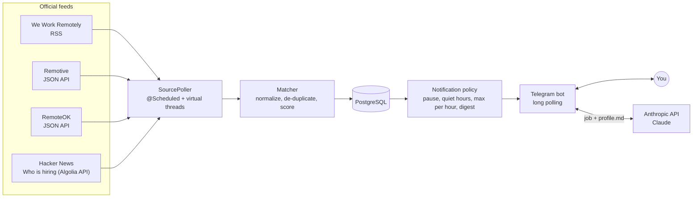

# Freelance Job Radar

A self-hosted **Telegram bot that watches official remote-job feeds**, keeps only the jobs that match *your* skills (weighted keywords you control),
and sends them to you with a score and the reasons it matched. One tap drafts a **tailored proposal with Claude**, grounded in your own profile.

- Polls four official sources on their own intervals, de-duplicates in PostgreSQL, scores each job from a YAML config.
- Never spams: pause switch, quiet hours with a morning digest, and a hard hourly message limit.
- AI is optional: without an API key everything still works and the *Draft proposal* button tells you how to enable it.

Built with **Java 21 · Spring Boot 3.5 · PostgreSQL + Flyway · Telegram long polling · Anthropic Java SDK · Docker**.



## Features

- **Four official sources**, each switchable and with its own poll interval: We Work Remotely (RSS), Remotive (JSON API), RemoteOK (JSON API) and the current *Ask HN: Who is hiring?* thread (HN Algolia API).
- **Resilient fetching**: descriptive `User-Agent`, connect/read timeouts, retries with exponential backoff on transient errors, no retry on `429`/`4xx`. One failing source never affects the others.
- **Normalized `Job` record** (source, external id, title, company, url, tags, description, salary, posted-at), **de-duplicated** by `(source, external id)` *and* by normalized URL, enforced by unique constraints in Postgres.
- **Transparent scoring**: weighted include keywords, exclude keywords, minimum score. The score and the matched keywords are stored and shown, so you can see *why* a job matched.
- **Single-owner Telegram bot**: only your chat id can use it; everyone else gets a polite "private bot" reply.
- **Job cards** with title, company, source, score, matched keywords, short description, link and buttons: **✍️ Draft proposal · ⭐ Save · 🙈 Hide**.
- **AI proposals** (5–8 sentences, mirrors the client's problem, mentions one relevant portfolio project, ends with a question), built only from your `profile.md`, sent back as a copy-friendly message.
- **Commands**: `/start` `/help` `/keywords` `/saved` `/stats` `/pause` `/resume` `/digest`.
- **Quiet hours** (default 00:00–08:00 `Asia/Baku`): matches are queued and sent as **one digest** in the morning.
- **Hourly limit** (default 6 cards/hour): the overflow goes into the next digest.
- Structured JSON logs in Docker, Spring Actuator health (`/actuator/health`), graceful shutdown.

What a job card looks like (plain text rendering of the Telegram message):

```
Senior Java Backend Engineer
🏢 PayLane · via Remotive
🎯 Score 12 — java, spring, kafka, payments, backend
💰 $90k - $120k

We build payments infrastructure and need a Java engineer. Spring Boot & Kafka, PostgreSQL. Fully remote.

🔗 View on Remotive
[ ✍️ Draft proposal ]
[ ⭐ Save ] [ 🙈 Hide ]
```

## Run in 2 minutes

Requirements: Docker with Compose.

1. **Create a bot.** In Telegram open [@BotFather](https://t.me/BotFather) → `/newbot` → copy the token.
2. **Configure.**
   ```bash
   cp .env.example .env
   cp config/profile.example.md config/profile.md
   ```
   Put the token into `.env` as `TELEGRAM_BOT_TOKEN`. Edit `config/profile.md` (your skills, experience, portfolio links) and, if you like, `config/keywords.yml`.
3. **Start.**
   ```bash
   docker compose up -d --build
   ```
4. **Get your chat id.** Open your bot in Telegram and send `/start`. While no owner is configured, the bot answers with *your* chat id and nothing else. Put it into `.env` as `TELEGRAM_OWNER_CHAT_ID` and restart:
   ```bash
   docker compose up -d
   ```
5. **Optional – AI proposals.** Set `ANTHROPIC_API_KEY` in `.env` and run `docker compose up -d` again.

Check that it is alive:

```bash
curl http://127.0.0.1:8080/actuator/health    # {"status":"UP", ...}
docker compose logs -f app                    # JSON logs; poll results look like event=poll_ok source=remotive fetched=... new=... matched=...
```

The first start polls every source immediately. Jobs posted more than 7 days ago are stored but not sent (`notify-max-age`), so you do not get a flood of stale jobs. After a restart, sources are **not** polled again before their interval has elapsed (poll times are stored in the database).

Missing keys are not an error. Without a bot token the app still collects and stores jobs and logs one clear warning; without an Anthropic key the *Draft proposal* button explains how to enable AI.

## Example `config/profile.md`

The proposal writer may only use facts from this file. It is read on every draft, so edits apply immediately.

```markdown
# Profile
Alex Example — backend engineer, Baku (UTC+4), remote with EU/US teams.
2+ years of backend experience in banking: card payments, account ledgers, reconciliation.

## Core skills
- Java 21, Spring Boot 3, Spring Data JPA, PostgreSQL, Flyway
- Apache Kafka, Elasticsearch, Docker, GitHub Actions
- JUnit 5, Mockito, Testcontainers, WireMock

## What I do not do (do not claim these)
- Frontend, mobile, large-scale Kubernetes operations

## Portfolio
- **freelance-job-radar** — Telegram bot that finds remote jobs and drafts AI proposals. https://github.com/BabakBaylarli/freelance-job-radar
- **ledger-service** — double-entry ledger with idempotent Kafka consumers. https://github.com/your-name/ledger-service
```

A fuller template is in [`config/profile.example.md`](config/profile.example.md).

## Example keyword config

[`config/keywords.yml`](config/keywords.yml) (mounted into the container; restart the app after editing):

```yaml
jobradar:
  matching:
    min-score: 5            # send jobs with score >= 5 that are not excluded
    notify-max-age: P7D     # older jobs are stored but not sent
    include:                # score = sum of weights of the keywords found (each counts once)
      - { term: java, weight: 3 }
      - { term: spring, weight: 3 }
      - { term: kafka, weight: 2 }
      - { term: elasticsearch, weight: 2 }
      - { term: fintech, weight: 2 }
      - { term: payments, weight: 2 }
      - { term: backend, weight: 1 }
    exclude:                # any hit vetoes the job
      - onsite
      - hybrid
      - principal
      - us only
```

Matching is case-insensitive on whole terms in title, tags and description: `java` does not match `JavaScript`, while `spring boot` and `c++` work. Send `/keywords` to the bot to see the active configuration.

## Configuration

Everything has a default in [`application.yml`](src/main/resources/application.yml); secrets and the common knobs come from the environment (see [`.env.example`](.env.example)).

| Setting | Env var | Default |
| --- | --- | --- |
| Telegram bot token | `TELEGRAM_BOT_TOKEN` | – (bot disabled) |
| Owner chat id | `TELEGRAM_OWNER_CHAT_ID` | – (setup mode) |
| Anthropic API key | `ANTHROPIC_API_KEY` | – (AI disabled) |
| Model | `ANTHROPIC_MODEL` | `claude-sonnet-5-5` |
| Max job cards per hour | `NOTIFY_MAX_PER_HOUR` | `6` |
| Quiet hours | `QUIET_HOURS_ENABLED` / `_START` / `_END` / `_ZONE` | `true` / `00:00` / `08:00` / `Asia/Baku` |
| Profile file | `PROFILE_PATH` | `config/profile.md` |
| Source on/off + interval | `jobradar.sources.<name>.enabled` / `.poll-interval` | all on, 3–6 h |

Per-source settings live under `jobradar.sources` (`we-work-remotely`, `remotive`, `remote-ok`, `hacker-news`), for example `JOBRADAR_SOURCES_REMOTIVE_ENABLED=false`.

### How "never spam" works

1. **Paused** (`/pause`): nothing is sent; matches wait. `/resume` continues.
2. **Quiet hours**: matches are deferred and go out as a single digest after the window ends.
3. **Hourly limit**: the best-scoring matches are sent as cards until the limit is reached; the rest are deferred.
4. **Digest**: the top 10 deferred matches in one message with per-job buttons. Sent when something is deferred, it is not quiet time and the last digest is at least 6 h old. `/digest` sends one on demand (ignoring pause and quiet hours).

## Why only official feeds

This project is deliberately conservative, so you can run it without worrying about your accounts or about hammering other people's sites:

- It reads **RSS feeds and JSON APIs the sources publish for this purpose**: We Work Remotely's category RSS feeds, Remotive's public API, RemoteOK's public API and Hacker News' official Algolia API.
- **No HTML scraping**, no headless browsers, no login-protected data.
- **No Upwork / Fiverr / LinkedIn automation** and **no auto-applying**: the bot only *finds* jobs and *drafts* text. You read it, edit it and send it yourself.
- It follows each source's published usage notes: Remotive is polled at most 4 times a day (6 h interval, and a warning is logged if you configure less), and the job URL from the source is always the link shown to you (Remotive and RemoteOK ask for a link back and attribution, so every message says "via <source>" and links to the original posting).
- A descriptive `User-Agent` identifies the client, timeouts and backoff keep failures polite, and `429`/`4xx` responses are never retried in a loop.

Source terms can change. Before pointing this at production, check the current terms of each source you enable; every source can be switched off in config.

## Development

```bash
mvn clean verify          # unit, WireMock and Testcontainers tests (needs Docker for Postgres)
```

Run the app against a local Postgres:

```bash
docker run -d --name jobradar-pg -p 127.0.0.1:5432:5432 \
  -e POSTGRES_DB=jobradar -e POSTGRES_USER=jobradar -e POSTGRES_PASSWORD=jobradar postgres:16-alpine
mvn spring-boot:run                      # defaults point at localhost:5432/jobradar
```

### Project layout

```
src/main/java/com/babakbaylarli/jobradar/
├── config/       typed properties (JobRadarProperties), quiet-hours window, clock
├── source/       JobSource interface, 4 adapters, retrying HttpFetcher, SourcePoller
├── matching/     KeywordScorer, UrlNormalizer, JobIngestService (dedupe + score + store)
├── persistence/  JPA entities and repositories, Flyway migration in resources/db/migration
├── bot/          Telegram entry point, command/callback handler, NotificationService, message formatting
└── ai/           prompt builder, Anthropic client wrapper, ProposalService
```

### Tests

| What | How |
| --- | --- |
| Scoring, URL normalization, de-duplication, quiet-hours window, prompt building, message formatting | JUnit 5 + Mockito |
| Each source parser and fetch path | saved sample payloads in `src/test/resources/samples` served by WireMock |
| Retry/backoff, `429` handling, `User-Agent` | WireMock |
| Anthropic request/response handling | WireMock against the Messages API |
| Flyway migration, unique constraints, queries | Testcontainers PostgreSQL |
| Notification policy (pause, quiet hours, hourly limit, digest) | Testcontainers PostgreSQL + a recording Telegram gateway |
| Whole app boots with no Telegram/AI keys, health is `UP`, feed → scoring → Postgres | `@SpringBootTest` + Testcontainers + WireMock |

The sample payloads in the repo are hand-written to follow each source's documented response format (live payloads are third-party content and are not committed). The four adapters were also run once against the live feeds on 2026-11-27: We Work Remotely, Remotive, RemoteOK and Hacker News parsed 26, 16, 100 and 132 jobs with dates, URLs and company names.

CI (GitHub Actions) runs `mvn clean verify` and builds the Docker image on every push and pull request.

### About the AI call

Proposals use the official `com.anthropic:anthropic-java` SDK. The model is configurable (`ANTHROPIC_MODEL`, default `claude-sonnet-5-5`). The job posting is passed inside delimiter tags and the model is instructed to treat it as untrusted data, so text inside a posting cannot change the rules. The prompt rules require 5–8 sentences, one relevant portfolio project, a closing question, and no claims beyond `profile.md`.

## Troubleshooting

| Symptom | Fix |
| --- | --- |
| Bot replies with "Setup mode … your chat id is …" | Put that id into `TELEGRAM_OWNER_CHAT_ID` and `docker compose up -d`. |
| Bot replies "private bot" | You are not the configured owner. |
| *Draft proposal* says AI is disabled | Set `ANTHROPIC_API_KEY`, then `docker compose up -d`. |
| *Draft proposal* says it cannot find your profile | Create `config/profile.md` from `config/profile.example.md`. |
| No jobs arrive | `/stats` shows per-source results and failures; lower `min-score` or add keywords; check quiet hours and `/pause`. |
