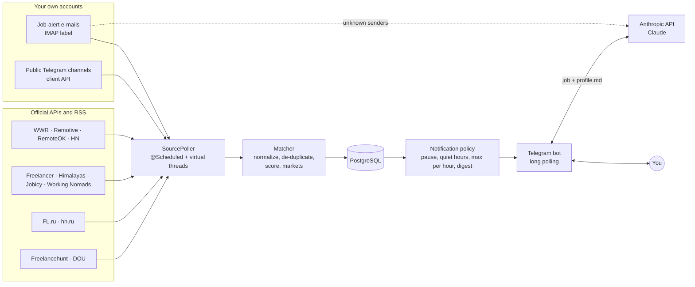

# Freelance Job Radar

A self-hosted **Telegram bot that watches official job sources in several markets** (international, Russia, Ukraine, Azerbaijan),
keeps only the jobs that match *your* skills (weighted keywords you control, in several languages), and sends them to you with
a score and the reasons it matched. One tap drafts a **tailored proposal with Claude**, grounded in your own profile.

- Polls official APIs and RSS feeds, reads your own job-alert e-mails and (optionally) public Telegram channels; de-duplicates in PostgreSQL, also across platforms.
- Never spams: pause switch, quiet hours with a morning digest, hard hourly limit, per-market on/off.
- Everything optional is optional: a source whose token is missing is skipped with one clear warning, and AI is off without a key.

Built with **Java 21 · Spring Boot 3.5 · PostgreSQL + Flyway · Telegram long polling · Anthropic Java SDK · Docker**.



## Features

- **14 sources**, each switchable and with its own poll interval: see the [sources table](#sources) below.
- **Markets**: every job is 🌍 International, 🇷🇺 Russia, 🇺🇦 Ukraine or 🇦🇿 Azerbaijan, and is a *freelance project*, a *remote job* or a *vacancy*. `/markets` switches markets on and off.
- **Resilient fetching**: descriptive `User-Agent`, timeouts, retries with exponential backoff on transient errors, no retry on `429`/`4xx`, per-source error state. One failing source never affects the others.
- **De-duplication** by `(source, external id)` and by normalized URL (Postgres unique constraints) **and across platforms**: the same posting (same title + company/budget within 3 days) seen on several platforms is one notification listing every link.
- **Transparent scoring**: weighted keywords **with aliases** (Russian / Ukrainian / Azerbaijani spellings), exclude keywords, minimum score and a **minimum budget per currency** for freelance projects. Score and matched keywords are stored and shown.
- **Single-owner Telegram bot**: only your chat id can use it; everyone else gets a polite "private bot" reply.
- **Job cards** with market flag, type, company, source, score, matched keywords, short description, budget, link(s) and buttons **✍️ Draft proposal · ⭐ Save · 🙈 Hide**.
- **AI proposals** (5–8 sentences, mirrors the client's problem, mentions one relevant portfolio project, ends with a question), built only from your `profile.md`.
- **One-tap apply, always human-approved**: draft → edit → approve → (confirm) → send where the platform officially allows it, otherwise a copy-ready text and the job link. Nothing is ever sent without your explicit approval of that specific job. See [One-tap apply](#one-tap-apply).
- **Commands**: `/start` `/help` `/keywords` `/saved` `/stats` `/sources` `/markets` `/applied` `/limits` `/pause` `/resume` `/digest`.
- **Quiet hours** (default 00:00–08:00 `Asia/Baku`): matches are queued and sent as **one digest** in the morning. **Hourly limit** (default 6 cards/hour): the overflow goes into the next digest.
- Structured JSON logs in Docker, Spring Actuator health (`/actuator/health`), graceful shutdown.

What a job card looks like (plain text rendering of the Telegram message):

```
Доработка Java-сервиса оплаты
🇷🇺 Freelance project
via FL.ru
🎯 Score 12 — java, spring, kafka, payments, backend
💰 45,000 RUB

Нужно доработать сервис платежей на Spring Boot. Интеграция с Kafka.

🔗 View on FL.ru
🔗 Also on Freelancehunt
[ ✍️ Draft proposal ]
[ ⭐ Save ] [ 🙈 Hide ]
```

## Run in 2 minutes

Requirements: Docker with Compose.

1. **Create a bot.** In Telegram open [@BotFather](https://t.me/BotFather) → `/newbot` → copy the token.
2. **Configure.**
   ```bash
   cp .env.example .env
   cp config/profile.example.md config/profile.md
   ```
   Put the token into `.env` as `TELEGRAM_BOT_TOKEN`. Edit `config/profile.md` (your skills, experience, portfolio links) and, if you like, `config/keywords.yml`.
3. **Start.**
   ```bash
   docker compose up -d --build
   ```
4. **Get your chat id.** Open your bot in Telegram and send `/start`. While no owner is configured, the bot answers with *your* chat id and nothing else. Put it into `.env` as `TELEGRAM_OWNER_CHAT_ID` and restart:
   ```bash
   docker compose up -d
   ```
5. **Optional.** Add `ANTHROPIC_API_KEY` for AI proposals, and the tokens of the sources you want (see [Set up each source](#set-up-each-source)). Run `docker compose up -d` after every change of `.env`.

Check that it is alive:

```bash
curl http://127.0.0.1:8080/actuator/health    # {"status":"UP", ...}
docker compose logs -f app                    # JSON logs; poll results look like event=poll_ok source=remotive fetched=... new=... matched=...
```

Then send `/sources` to the bot: it lists every source as 🟢 on, ⚪ off or 🟡 skipped (with the reason, e.g. `HH_CONTACT_EMAIL is not set`).

The first start polls every source immediately. Jobs posted more than 7 days ago are stored but not sent (`notify-max-age`), so you do not get a flood of stale jobs. After a restart, sources are **not** polled again before their interval has elapsed (poll times are stored in the database).

Missing keys are never an error. Without a bot token the app still collects and stores jobs and logs one clear warning; without an Anthropic key the *Draft proposal* button explains how to enable AI.

## Sources

| Source | Market · type | Access method | Auth needed | Terms notes |
| --- | --- | --- | --- | --- |
| We Work Remotely | 🌍 remote job | public RSS feeds (programming, back-end) | – | Link back to the posting is kept; poll every 3 h. |
| Remotive | 🌍 remote job | public JSON API `/api/remote-jobs?category=software-dev` | – | Remotive asks for at most a few polls a day: default 6 h = 4/day (a warning is logged below that); link back to the original job. |
| RemoteOK | 🌍 remote job | public JSON API `/api` | – | Attribution + link back: only RemoteOK's own job URL is used, every message says "via RemoteOK". |
| Hacker News "Who is hiring?" | 🌍 remote job | official HN Algolia API (current thread) | – | Link is the comment's own news.ycombinator.com URL. |
| Freelancer.com | 🌍 freelance project | Projects API `/api/projects/0.1/projects/active/` | optional `FREELANCER_TOKEN` | Works anonymously; project link built from `seo_url`; budget + currency mapped. One request per query. |
| Himalayas | 🌍 remote job | public jobs search API | optional `HIMALAYAS_API_KEY` | Anonymous use is rate limited (HTTP 429): one search request per poll; a free key raises the limit. Link is the Himalayas job page. |
| Jobicy | 🌍 remote job | public JSON API v2 `/api/v2/remote-jobs?tag=...` | – | Their feed notice asks for credit and links to the original job URL: done ("via Jobicy"). |
| Working Nomads | 🌍 remote job | public JSON API `/api/exposed_jobs/` | – | Their own job link is kept. |
| FL.ru | 🇷🇺 freelance project | official RSS `/rss/all.xml?category=5` (programming); list of feeds is configurable | – | Budget is parsed out of the title. |
| hh.ru | 🇷🇺 vacancy (remote, project/part-time) | official API `GET /vacancies` with `work_format=REMOTE`, `employment_form=PROJECT,PART` | `HH_CONTACT_EMAIL` | hh.ru requires an identifying `HH-User-Agent` (`FreelanceJobRadar/1.0 (<your email>)`) and rejects generic or placeholder agents. Skipped while the email is empty. The older `schedule`/`employment` parameters are deprecated by hh.ru and not used. |
| Freelancehunt | 🇺🇦 freelance project | official API v2 `GET /v2/projects` | `FREELANCEHUNT_TOKEN` | Skipped with a warning without the token. Only a company name is stored, never a private person's name. |
| DOU | 🇺🇦 vacancy | official vacancy RSS `/vacancies/feeds/?category=Java&remote` | – | Categories are configurable. |
| Email alerts | per sender | IMAP, a dedicated Gmail label | Gmail App Password | Upwork, Djinni, LinkedIn, Guru, PeoplePerHour, Kwork and any other sender. See [Set up email alerts](#set-up-email-alerts). |
| Telegram channels | per channel | official Telegram client API (MTProto) with your own account | `TELEGRAM_API_ID/HASH/PHONE` + one-time login | Reads public channels you list; never joins, posts or messages. Off by default. See [Telegram channels](#telegram-channels-ru--ua--az). |

### What is not supported, and why

- **Habr Freelance** ("Хабр Фриланс"): the service has closed permanently, its feed URL now serves a closure notice, so no adapter exists.
- **Fiverr**: it has no job feed for sellers (buyer requests are not published as an API or feed).
- **Upwork, Kwork, LinkedIn, Djinni, Guru, PeoplePerHour**: no public job API we may use. They work **only through their own alert e-mails** (see below); nothing is scraped and no account is logged in to.
- **Azerbaijani boards** (boss.az, jobsearch.az, hellojob.az): no public API; use their e-mail subscriptions and the fallback parser below.

## Set up each source

Most sources need nothing. Fill these in `.env`, then `docker compose up -d`:

| Variable | Source | How to get it |
| --- | --- | --- |
| `FREELANCER_TOKEN` | Freelancer.com (optional) | Freelancer developer portal → create an app → personal access token. |
| `HIMALAYAS_API_KEY` | Himalayas (optional) | Free key at himalayas.app/signup/developer. |
| `HH_CONTACT_EMAIL` | hh.ru | **Your** email address; it identifies the client to hh.ru. Without it hh.ru is skipped. |
| `FREELANCEHUNT_TOKEN` | Freelancehunt | freelancehunt.com → profile settings → API token. Skipped without it. |

Per-source intervals and on/off switches live in `application.yml` under `jobradar.sources`, for example `JOBRADAR_SOURCES_REMOTIVE_ENABLED=false` or `JOBRADAR_SOURCES_DOU_POLL_INTERVAL=PT12H`.

## Set up email alerts

For platforms without a public API, the bot reads the **alert e-mails the platform sends you**. It connects over IMAP to **one dedicated Gmail label only** (default `JobAlerts`), reads only **unread** messages and marks them read after their jobs were stored. It never opens your inbox or any other label. Message bodies are never logged.

1. **Enable IMAP** in Gmail: Settings → *See all settings* → *Forwarding and POP/IMAP* → *Enable IMAP*.
2. **Create an App Password** (needs 2-Step Verification): Google Account → Security → *App passwords*. Use it instead of your normal password. Never put your real Gmail password anywhere.
3. **Create the label** `JobAlerts` (Gmail → Labels → *Create new label*) and make sure it is shown in IMAP (Settings → Labels → *Show in IMAP*).
4. **Create a filter** that puts the alert e-mails into that label: Settings → *Filters and Blocked Addresses* → *Create a new filter*, for example
   `from:(upwork.com OR djinni.co OR linkedin.com OR freelancer.com OR guru.com OR peopleperhour.com OR kwork.ru OR boss.az OR hellojob.az OR jobsearch.az)` → *Apply the label: JobAlerts* (optionally *Skip the Inbox*).
5. **Turn on job alert e-mails in each platform** (wording differs per platform and changes over time):
   - **Upwork**: save a search (e.g. "java backend") and enable *email notifications* for it.
   - **Djinni**: set up a subscription for your category/keywords with e-mail delivery.
   - **LinkedIn**: search jobs, switch on *Job alert* for the search and choose e-mail.
   - **Freelancer.com / Guru / PeoplePerHour**: enable e-mail notifications for new projects matching your skills.
   - **Kwork**: enable e-mail notifications about new projects in your categories.
   - **boss.az / hellojob.az / jobsearch.az**: subscribe to vacancy alerts for your keywords by e-mail.
6. **Configure** `.env`:
   ```
   EMAIL_ALERTS_ENABLED=true
   MAIL_USERNAME=you@gmail.com
   MAIL_APP_PASSWORD=the-16-character-app-password
   MAIL_FOLDER=JobAlerts
   ```

How an e-mail becomes jobs:

1. A message from a **known sender** (Upwork, Djinni, LinkedIn, Freelancer, Guru, PeoplePerHour, Kwork) goes to that sender's parser: it finds each job link in the HTML, takes the link text as title and the surrounding block as description, and reads the budget. Links wrapped in tracking redirects are decoded.
2. A message from **any other sender**, or a known sender whose layout changed, goes to **AI extraction** when `ANTHROPIC_API_KEY` is set. The e-mail is treated as untrusted: the model must answer with strict JSON, and every job's URL must be one that really occurs in the e-mail (the model cannot invent or inject links); anything invalid is dropped.
3. Without AI the e-mail becomes **one job** from its subject and its first real link (unsubscribe/privacy links are skipped).

The per-platform parsers are heuristics: platforms change their e-mail layout without notice. They are tested on saved sample e-mails in `src/test/resources/emails/` that follow each platform's usual layout, not on captured private mail. If one stops matching, the fallbacks above keep the alert from being lost.

## Telegram channels (RU / UA / AZ)

Many freelance jobs in these markets are only posted in public Telegram channels. This source reads them through the **official Telegram client API (MTProto)** with **your own account** using [TDLight](https://github.com/tdlight-team/tdlight-java). It only reads the public channels you list: it never joins, posts or sends anything.

1. Get an **API id and hash** at <https://my.telegram.org> → *API development tools*.
2. Put them in `.env`, together with your phone number (international format), and enable the source:
   ```
   TELEGRAM_CHANNELS_ENABLED=true
   TELEGRAM_API_ID=123456
   TELEGRAM_API_HASH=0123456789abcdef0123456789abcdef
   TELEGRAM_PHONE=+994500000000
   ```
3. List the channels in [`config/channels.yml`](config/channels.yml) (empty by default; no channel names are pre-filled):
   ```yaml
   jobradar:
     sources:
       telegram-channels:
         channels:
           - { username: some_public_channel, market: RU, type: FREELANCE_PROJECT }
           - { username: another_channel,     market: AZ, type: VACANCY }
   ```
4. **Log in once** (Telegram sends a code to your phone; enter it, and your 2FA password if you have one):
   ```bash
   docker compose run --rm -it app --telegram-login
   ```
   The session is stored in the `tdlight-session` Docker volume. After that, `docker compose up -d` is all you need.

Each new post (text or media caption of at least 30 characters) becomes one job with a link to the post. The channel's `market` sets the default currency for budgets like "3000 грн". Telegram flood limits are respected: channels are read one after another with a pause, and a flood-wait error just makes that poll fail and retry later.

## One-tap apply

The bot drafts the application; **you** decide. There is no auto-apply, no batch sending and nothing on a timer: the only code path that can reach a platform runs when you press ✅ **Send** or reply **ok** to a draft (a test in the repository fails the build if another path is added).

**Flow in Telegram**

1. A matching job arrives with **✍️ Draft proposal · ⭐ Save · 🙈 Hide**.
2. **Draft** → the AI writes a proposal from your `profile.md` and the job (specific, 5–8 sentences, no invented skills, ends with a question). Platforms that need it also get a **suggested bid** (amount and days, from the client's budget and your minimum rates in `config/apply.yml`). The draft says which route will be used, and to whom it would go (e-mail address or `@username`).
3. The draft has **✅ Send · ✏️ Edit · 🔁 Regenerate · ❌ Cancel**. **Replying `ok` to the draft message** (also `ок`, `tamam`, `okay`) is the same as ✅ Send.
4. **✏️ Edit** → send your next message: the full edited text, or an instruction such as *shorter, mention Kafka* (when AI is on and the message is short), or `bid 650 5` to change the bid amount and days. The bot shows the updated draft and asks again; nothing is sent while editing.
5. **Send** → for limited actions a one-line confirmation first, e.g. *"This uses 1 of your Freelancer.com bids. Send? ✅ / ❌"* (replying `ok` to it also confirms). After sending you get the result and a link; the application is stored.
6. Where there is no official way to submit, **Send** is replaced by **📋 Copy & open**: the proposal arrives as one copy-friendly message with the job link, and you submit it yourself in seconds.
7. If a send fails, you see the error with **🔁 Retry** and **📋 Copy & open**. Nothing is retried automatically (a retry after a timeout could submit twice).

**Safety rails**

- A **daily limit** (default 10 sent applications in total, optionally lower per platform in `config/apply.yml`) and a **minimum gap** between sends (default 2 min). `/limits` shows today's usage.
- **Never the same job twice**: enforced by the service and by a unique index in the database.
- Every application is stored (job, route, text, bid, status `SENT` / `FAILED` / `COPIED`, timestamps, the platform's response id). `/applied` lists the last 20.
- Secrets only come from the environment; tokens, passwords and e-mail bodies are never logged.

**What the bot can send, and what it cannot**

| Platform | Can the bot send? | How | What you need |
| --- | --- | --- | --- |
| Freelancer.com | **Yes** | Official Projects API: bidder id from `GET /api/users/0.1/self/`, then `POST /api/projects/0.1/bids/` (`project_id`, `bidder_id`, `description`, `amount`, `period`), as in Freelancer's own SDK. Asks for a final confirmation because a bid uses one of your limited monthly bids. | `FREELANCER_TOKEN` with permission to place bids. The remaining-bids count is not shown: the SDK exposes no such call. |
| Jobs that name a contact **e-mail** (DOU, Telegram, Hacker News posts...) | **Yes** | Your own Gmail over SMTP (the same App Password as the alert e-mails): subject, proposal, portfolio links, optional `config/cv.pdf` attached. | `MAIL_USERNAME`, `MAIL_APP_PASSWORD`; the posting must contain an address. |
| Telegram channel posts that name a contact **@username** | **Yes** | One direct message from your own account through the official client API. Never to bots, never a follow-up, flood-wait answers are shown, not retried. | The Telegram client setup (API id/hash, `--telegram-login`). |
| hh.ru | No → Copy & open | The current official hh.ru API specification (`api.hh.ru/openapi`) has no endpoint for an applicant to respond to a vacancy (only employer-side negotiation actions), so nothing is automated. | – |
| Freelancehunt | No → Copy & open | The API links a bids collection per project, but its documentation could not be reached to confirm the request format, so nothing is guessed. | – |
| Upwork, Fiverr, Kwork, Djinni, LinkedIn, FL.ru, Guru, PeoplePerHour | No → Copy & open | No submission API for applicants, or their terms do not allow automation. | – |

Settings: [`config/apply.yml`](config/apply.yml) (minimum rates, per-platform limits, portfolio links) and `APPLY_DAILY_LIMIT` in `.env`. For Freelancer bids, `jobradar.apply.freelancer-milestone-percentage` can request an upfront milestone share; it is not sent unless you set it.

## Keywords, aliases, markets and budgets

[`config/keywords.yml`](config/keywords.yml) is mounted into the container (restart the app after editing):

```yaml
jobradar:
  matching:
    min-score: 5            # send jobs with score >= 5 that are not excluded
    notify-max-age: P7D     # older jobs are stored but not sent
    min-budget:             # freelance projects with a FIXED budget below this are vetoed (per currency)
      USD: 300
      RUB: 20000
      UAH: 10000
    include:                # score = sum of weights of the keywords found (each counts once)
      - { term: java, weight: 3 }
      - { term: spring, weight: 3 }
      - { term: kafka, weight: 2 }
      - { term: backend, weight: 1, aliases: [back-end, backend developer, бэкенд, бекенд] }
      - { term: developer, weight: 1, aliases: [разработчик, розробник, proqramçı] }
    exclude:                # any hit vetoes the job
      - onsite
      - hybrid
      - us only
```

- Matching is case-insensitive on **whole words** in title, tags and description: `java` does not match `JavaScript`; `spring boot`, `c++` and Cyrillic words work.
- **Aliases** are other spellings or languages of the same keyword. A keyword counts once however many of its aliases appear, and is reported by its main term.
- **Minimum budget** only applies to freelance projects with a fixed budget (the upper bound is compared). Hourly rates, salaries of vacancies and projects without a stated budget are never filtered by it.
- Send `/keywords` to see the active configuration, `/markets` to switch 🌍 🇷🇺 🇺🇦 🇦🇿 on or off (jobs of a switched-off market are still collected, just not sent).

## Example `config/profile.md`

The proposal writer may only use facts from this file. It is read on every draft, so edits apply immediately.

```markdown
# Profile
Alex Example — backend engineer, Baku (UTC+4), remote with EU/US teams.
2+ years of backend experience in banking: card payments, account ledgers, reconciliation.

## Core skills
- Java 21, Spring Boot 3, Spring Data JPA, PostgreSQL, Flyway
- Apache Kafka, Elasticsearch, Docker, GitHub Actions
- JUnit 5, Mockito, Testcontainers, WireMock

## What I do not do (do not claim these)
- Frontend, mobile, large-scale Kubernetes operations

## Portfolio
- **freelance-job-radar** — Telegram bot that finds remote jobs and drafts AI proposals. https://github.com/BabakBaylarli/freelance-job-radar
- **ledger-service** — double-entry ledger with idempotent Kafka consumers. https://github.com/your-name/ledger-service
```

A fuller template is in [`config/profile.example.md`](config/profile.example.md).

## Configuration

Everything has a default in [`application.yml`](src/main/resources/application.yml); secrets and the common knobs come from the environment (see [`.env.example`](.env.example), which documents every variable).

| Setting | Env var | Default |
| --- | --- | --- |
| Telegram bot token | `TELEGRAM_BOT_TOKEN` | – (bot disabled) |
| Owner chat id | `TELEGRAM_OWNER_CHAT_ID` | – (setup mode) |
| Anthropic API key | `ANTHROPIC_API_KEY` | – (AI disabled) |
| Model | `ANTHROPIC_MODEL` | `claude-sonnet-5-5` |
| Max job cards per hour | `NOTIFY_MAX_PER_HOUR` | `6` |
| Quiet hours | `QUIET_HOURS_ENABLED` / `_START` / `_END` / `_ZONE` | `true` / `00:00` / `08:00` / `Asia/Baku` |
| Profile file | `PROFILE_PATH` | `config/profile.md` |
| Source on/off + interval | `jobradar.sources.<name>.enabled` / `.poll-interval` | see `application.yml` |

### How "never spam" works

1. **Paused** (`/pause`): nothing is sent; matches wait. `/resume` continues.
2. **Markets**: only enabled markets are considered (`/markets`).
3. **Quiet hours**: matches are deferred and go out as a single digest after the window ends.
4. **Hourly limit**: the best-scoring matches are sent as cards until the limit is reached; the rest are deferred.
5. **Digest**: the top 10 deferred matches in one message with per-job buttons. Sent when something is deferred, it is not quiet time and the last digest is at least 6 h old. `/digest` sends one on demand (ignoring pause and quiet hours).

## Why only official channels

This project is deliberately conservative, so you can run it without worrying about your accounts or about hammering other people's sites:

- It reads **APIs and RSS feeds the sources publish for this purpose**, **alert e-mails the platforms send to you**, and **public Telegram channels through Telegram's official client API**.
- **No HTML scraping**, no headless browsers, **no logging in to Upwork / Fiverr / Kwork / LinkedIn with your account**, and **no auto-applying**: the bot only *finds* jobs and *drafts* text. You read it, edit it and send it yourself.
- It follows each source's published usage notes: Remotive is polled at most 4 times a day, Himalayas with a single search request per poll, hh.ru is called with the identifying header it requires, and the job URL from the source is always the link shown to you ("via <source>").
- A descriptive `User-Agent` identifies the client, timeouts and backoff keep failures polite, and `429`/`4xx` responses are never retried in a loop.

Source terms can change. Before pointing this at production, check the current terms of each source you enable; every source can be switched off in config.

## Development

```bash
mvn clean verify          # unit, WireMock, GreenMail and Testcontainers tests (needs Docker for Postgres)
```

Run the app against a local Postgres:

```bash
docker run -d --name jobradar-pg -p 127.0.0.1:5432:5432 \
  -e POSTGRES_DB=jobradar -e POSTGRES_USER=jobradar -e POSTGRES_PASSWORD=jobradar postgres:16-alpine
mvn spring-boot:run                      # defaults point at localhost:5432/jobradar
```

The Telegram client library (TDLight) is published on its own Maven repository (`mvn.mchv.eu`, configured in `pom.xml`).

### Project layout

```
src/main/java/com/babakbaylarli/jobradar/
├── config/       typed properties (JobRadarProperties), quiet-hours window, clock
├── source/       JobSource interface, adapters (feeds, API), retrying HttpFetcher, SourcePoller, SourceCatalog
│   ├── email/    IMAP alert source, per-platform parsers, AI-free fallback
│   └── telegram/ channel source on TDLight, one-time login command
├── matching/     KeywordScorer, UrlNormalizer, DedupKey, JobIngestService (dedupe + score + store)
├── persistence/  JPA entities and repositories, Flyway migrations in resources/db/migration
├── apply/        ApplicationService (approval state machine, limits), senders (Freelancer API, SMTP, Telegram DM), BidAdvisor
├── bot/          Telegram entry point, command/callback handler, NotificationService, message formatting
└── ai/           prompt builder, Anthropic client wrapper, ProposalService, AiJobExtractor
```

### Tests

| What | How |
| --- | --- |
| Scoring (aliases, minimum budget), URL normalization, de-duplication incl. cross-source merging, quiet hours, prompt building, message formatting | JUnit 5 + Mockito |
| Every source adapter's parser and fetch path | saved sample payloads in `src/test/resources/samples` served by WireMock |
| E-mail parsers per platform | saved sample e-mails in `src/test/resources/emails` |
| IMAP source (only the alert label is read, mail stays unread until the jobs are stored, wrong credentials, missing label) | GreenMail (real IMAP protocol) |
| AI extraction fallback (strict JSON, invented URLs dropped) and the Anthropic request/response handling | mocked model / WireMock against the Messages API |
| Telegram channel source | fake `ChannelReader`; login command's configuration check |
| Retry/backoff, `429` handling, `User-Agent`, tokens in headers | WireMock |
| Flyway migrations, unique constraints, queries | Testcontainers PostgreSQL |
| Notification policy (pause, quiet hours, hourly limit, digest, markets) | Testcontainers PostgreSQL + a recording Telegram gateway |
| One-tap apply: state machine (draft → edit → confirm → send), `ok` reply handling, limits, duplicate protection, retry/copy fallbacks | JUnit + Testcontainers PostgreSQL with fake senders; bot handler with a mocked service |
| Senders: Freelancer bid (payload, no retry, errors), e-mail (real SMTP protocol, attachment), Telegram DM (contact rules) | WireMock, GreenMail, fake messenger |
| "Nothing sends automatically" | tripwire tests that scan the sources for any other path to a sender |
| Whole app boots with no keys at all, with every default source on, health is `UP`; feed → scoring → Postgres | `@SpringBootTest` + Testcontainers + WireMock |

What the tests do **not** cover, honestly: sending to the real platforms (the Freelancer.com bid, SMTP to a real mailbox, a real Telegram message) was only exercised against recorded protocol behaviour and test servers, never with a real account. the sample payloads and e-mails are written to follow each source's real format (every JSON/RSS adapter except hh.ru was additionally run once against the live feed on 2026-11-27 and parsed it), but the e-mail parsers have only seen synthetic e-mails, hh.ru needs your registered contact address to answer at all, and the TDLight channel reader needs a real Telegram login, so it is tested through its interface and its pure helpers only.

CI (GitHub Actions) runs `mvn clean verify` and builds the Docker image on every push and pull request.

### About the AI call

Proposals use the official `com.anthropic:anthropic-java` SDK. The model is configurable (`ANTHROPIC_MODEL`, default `claude-sonnet-5-5`). The job posting is passed inside delimiter tags and the model is instructed to treat it as untrusted data, so text inside a posting cannot change the rules. The prompt rules require 5–8 sentences, one relevant portfolio project, a closing question, and no claims beyond `profile.md`.

## Troubleshooting

| Symptom | Fix |
| --- | --- |
| Bot replies with "Setup mode … your chat id is …" | Put that id into `TELEGRAM_OWNER_CHAT_ID` and `docker compose up -d`. |
| Bot replies "private bot" | You are not the configured owner. |
| A source does not deliver anything | Send `/sources`: it shows 🟡 skipped + reason (missing token/email), the last error and jobs in the last 24 h. |
| hh.ru is skipped or answers 400 | Set `HH_CONTACT_EMAIL` to your real address; hh.ru rejects generic user agents. |
| Himalayas shows HTTP 429 | Anonymous rate limit: lower `jobradar.sources.himalayas.queries` to one query or set `HIMALAYAS_API_KEY`. |
| Email source: "folder … does not exist" | Create the Gmail label `JobAlerts` and enable *Show in IMAP*. |
| Email source: IMAP error | Use an **App Password**, enable IMAP in Gmail, check `MAIL_USERNAME`. |
| Telegram channels: "session is not logged in" | Run `docker compose run --rm -it app --telegram-login` once. |
| *Draft proposal* says AI is disabled | Set `ANTHROPIC_API_KEY`, then `docker compose up -d`. |
| Replying `ok` does nothing | It must be a Telegram **reply** to the draft (or confirmation) message, from the owner's chat. |
| "Daily limit reached" / "wait ... s" | See `/limits`; change `APPLY_DAILY_LIMIT`, `min-gap` or `platform-limits`, or use Copy & open. |
| Freelancer bid refused | The error text is Freelancer's own (no bids left, invalid token, project closed...). Use Retry after fixing it, or Copy & open. |
| *Draft proposal* says it cannot find your profile | Create `config/profile.md` from `config/profile.example.md`. |
| No jobs arrive | `/stats` shows per-source and per-market results; lower `min-score`, add keywords or aliases; check quiet hours, `/pause` and `/markets`. |
